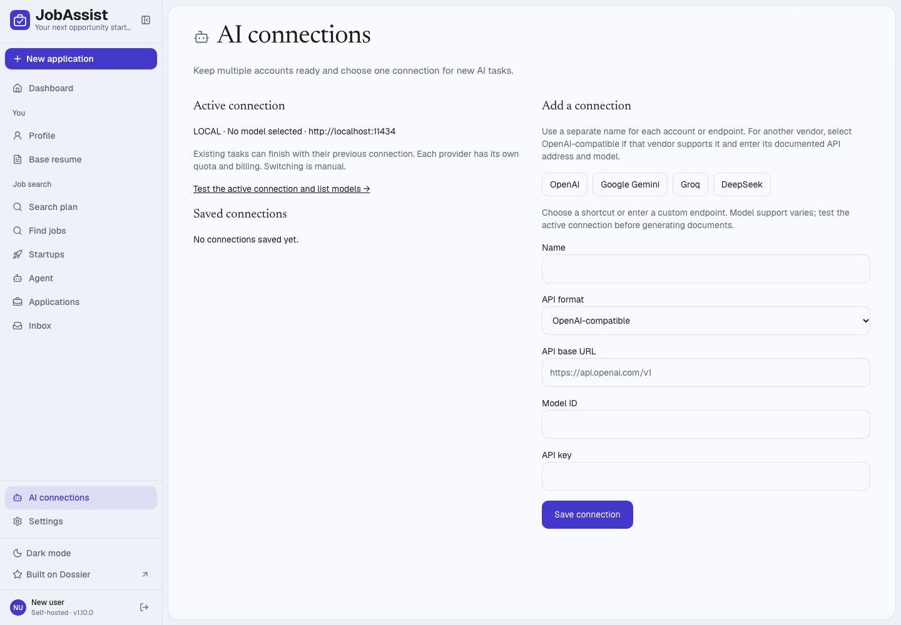

<p align="center"></p>
<h1 align="center">JobAssist</h1>
<p align="center">Your next opportunity starts here.</p>

JobAssist is HimaSagarB’s personal job-search assistant: maintain a professional profile, find relevant openings, prepare tailored documents, review applications, and track progress in one place.

This project extends the open-source Dossier foundation with our own search preferences, saved AI connections, local runtime setup, and visual identity. It is a working local application, with live account configuration still required before real AI generation and email submission.

## Our additions

| JobAssist addition | What we implemented |
| --- | --- |
| Search plan | Save target role phrases, locations, work arrangement and company exclusions; preview filters and apply them before the daily agent scores jobs. |
| Saved AI connections | Keep multiple named accounts and endpoints with encrypted keys. Activate one configuration for new tasks without losing other saved accounts. |
| Provider shortcuts | OpenAI, Gemini, Groq and DeepSeek endpoint shortcuts, alongside existing Anthropic, Mistral, local-model and custom compatible API formats. |
| Local startup | Persistent local PostgreSQL, configuration initialization, migrations and a production launcher without requiring Docker for the tested local setup. |
| JobAssist interface | A custom briefcase/checkmark logo, indigo accents, cooler surfaces, clearer navigation and refreshed sign-in page. |
| Workflow verification | Local production smoke checks and browser coverage for saved-account switching alongside the inherited application workflows. |

## Current interface



This screenshot shows our actual local build, before adding personal credentials.

## Application workflow

1. **Build your profile:** import a resume and review skills, experience, education and projects.
2. **Set preferences:** configure Search plan and a supported job source, or paste a job description directly.
3. **Choose AI:** save an API connection, activate it, and test it in Settings.
4. **Prepare:** analyze the posting and draft a tailored resume and cover letter; review and export PDFs.
5. **Approve and send:** with Google configured, review the recipient and application email before confirming Gmail submission.
6. **Track:** manage application stages, employer replies and interviews.

Profile import, document generation/editing, PDF rendering, job-source adapters, application tracking, and Gmail/Calendar integration originate in Dossier. See [ATTRIBUTION.md](ATTRIBUTION.md) for the boundary between the foundation and our work.

## Run locally

The local runtime was verified on an Apple Silicon Mac with Node.js 24. Platform support elsewhere has not been verified for this fork.

```sh
git clone https://github.com/HimaSagarB/JobAssist.git
cd JobAssist
npm install
npm install --prefix tools/local-db
npx playwright install chromium
npm run local:init
npm run local:db
```

Keep that terminal running. In a second terminal:

```sh
npm run local:prepare
npm run build -- --webpack
npm run local:start
```

Open **http://localhost:3000**. Initialization writes your generated password to `data/LOCAL-LOGIN.txt`; it refuses to overwrite an existing `.env`.

For later starts, run `npm run local:db` and `npm run local:start` in separate terminals. See [LOCAL-SETUP.md](LOCAL-SETUP.md) for configuration and restart details, and [DEVELOPMENT.md](DEVELOPMENT.md) for engineering notes.

## Verification and limitations

The recorded local validation passed a production build, lint, 35 focused unit tests and 17 browser tests. These browser tests use isolated databases and **fake AI, job-source and Google services**. Production login was also checked independently. These results are not a claim that current GitHub CI is green.

- Real AI quality and Gmail delivery require your profile, credentials and live verification.
- Provider switching is manual; quotas and billing still apply. Existing tasks may finish on the previously selected connection.
- Search-plan matching is phrase/text based, not semantic or geographic matching.
- The daily agent prepares drafts; it does not submit applications unattended.
- Employer website forms require manual submission. Universal auto-apply is not implemented.
- Scheduled tasks require the computer and app to remain running.
- This is a single-user, desktop-oriented app. It cannot guarantee interviews or a job.

See [BUILD-NOTES.md](BUILD-NOTES.md) for the recorded validation scope.

## Planned improvements

Skill evidence and learning updates, multiple saved job searches, stronger matching, approval records tied to exact document versions, and platform-specific application form support are future work—not current capabilities.

## Data and credentials

`.env`, `data/`, dependencies, generated outputs and browser authentication state are excluded from Git. API keys are encrypted on the server. Hosted AI providers receive the data needed for tasks you run. Saved AI connections are excluded from exports and retained locally during imports; removing a saved copy does not clear active settings.

Read [PRIVACY.md](PRIVACY.md) and [SECURITY.md](SECURITY.md). Keep your local database and encryption secret backed up privately.

## Ownership and license

JobAssist is maintained by [HimaSagarB](https://github.com/HimaSagarB). It is a modified work based on [Dossier by AienTech](https://github.com/AienTech/dossier), distributed under **AGPL-3.0-only**. The upstream license and attribution are retained. See [LICENSE](LICENSE) and [ATTRIBUTION.md](ATTRIBUTION.md).
