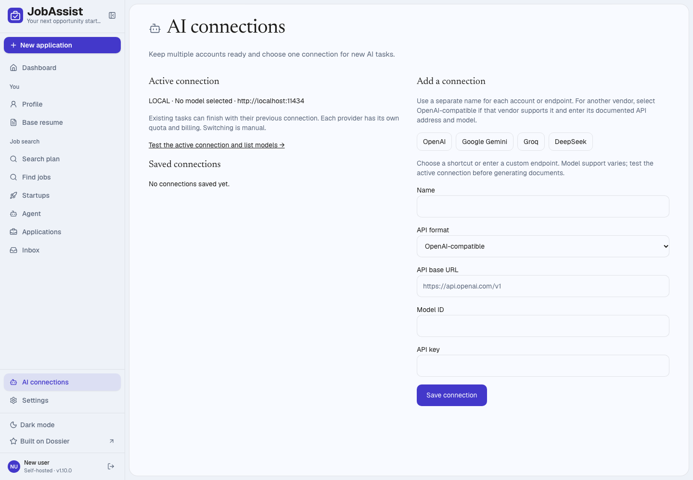

<p align="center"></p>
<h1 align="center">JobAssist</h1>
<p align="center">Your next opportunity starts here.</p>

JobAssist is HimaSagarB’s personal job-search assistant: maintain a professional profile, find relevant openings, prepare tailored documents, review applications, and track progress in one place.

It is a working local application, with live account configuration still required before real AI generation and email submission.

## Our additions

| JobAssist addition | What we implemented |
| --- | --- |
| Search plan | Save target role phrases, locations, work arrangement and company exclusions; preview filters and apply them before the daily agent scores jobs. |
| Saved AI connections | Keep multiple named accounts and endpoints with encrypted keys. Activate one configuration for new tasks without losing other saved accounts. |
| Provider shortcuts | OpenAI, Gemini, Groq and DeepSeek endpoint shortcuts, alongside existing Anthropic, Mistral, local-model and custom compatible API formats. |
| Local startup | Persistent local PostgreSQL, configuration initialization, migrations and a production launcher without requiring Docker for the tested local setup. |
| JobAssist interface | A custom briefcase/checkmark logo, indigo accents, cooler surfaces, clearer navigation and refreshed sign-in page. |
| Workflow verification | Local production smoke checks and browser coverage for saved-account switching alongside the application workflows. |

## Current interface



This screenshot shows our actual local build, before adding personal credentials.

## Application workflow

1. **Build your profile:** import a resume and review skills, experience, education and projects.
2. **Set preferences:** configure Search plan and a supported job source, or paste a job description directly.
3. **Choose AI:** save an API connection, activate it, and test it in Settings.
4. **Prepare:** analyze the posting and draft a tailored resume and cover letter; review and export PDFs.
5. **Approve and send:** with Google configured, review the recipient and application email before confirming Gmail submission.
6. **Track:** manage application stages, employer replies and interviews.

Profile import, document generation/editing, PDF rendering, job-source adapters, application tracking, and Gmail/Calendar integration are part of the application. See [ATTRIBUTION.md](ATTRIBUTION.md) for third-party source notices.

## Run locally

The local runtime was verified on an Apple Silicon Mac with Node.js 24. Platform support elsewhere has not been verified for this fork.

```sh
git clone https://github.com/HimaSagarB/JobAssist.git
cd JobAssist
npm install
npm install --prefix tools/local-db
npx playwright install chromium
npm run local:init
npm run local:db
```

Keep that terminal running. In a second terminal:

```sh
npm run local:prepare
npm run build -- --webpack
npm run local:start
```

Open **http://localhost:3000**. Initialization writes your generated password to `data/LOCAL-LOGIN.txt`; it refuses to overwrite an existing `.env`.

For later starts, run `npm run local:db` and `npm run local:start` in separate terminals. See [LOCAL-SETUP.md](LOCAL-SETUP.md) for configuration and restart details, and [DEVELOPMENT.md](DEVELOPMENT.md) for engineering notes.

## One-command daily routine

After the initial install/build, run this from any terminal folder:

```sh
npm --prefix ~/Desktop/Projects/JobAssist run daily
```

It starts the local database and production app if needed, reuses them if already running, and opens `http://localhost:3000/daily` on macOS. Sign in normally if asked. After authentication the daily page checks your setup, starts at most one search per local calendar day, and opens the agent review queue. A run already in progress is reused.

See [LOCAL-SETUP.md](LOCAL-SETUP.md) for first-time configuration, draft limits and shutdown behavior. Submission still requires confirmation.

## Run while your laptop is off

Cloud deployment preparation is documented in [HOSTING.md](HOSTING.md). `railway.json` selects the production container and database health check. Cloud resources, account access and deployment verification are still required; the GitHub repository alone does not host the running app.

## Verification and limitations

The current audit passed a production build, lint, **1,272 unit/interface tests** and **422 database tests**. **136 Chromium checks** and the actual local production login also passed. See [AUDIT.md](AUDIT.md) for scope. Browser tests use isolated databases and **fake AI, job-source and Google services**; they do not certify live provider output or employer delivery.

- Real AI quality and Gmail delivery require your profile, credentials and live verification.
- Provider switching is manual; quotas and billing still apply. Existing tasks may finish on the previously selected connection.
- Search-plan matching is phrase/text based, not semantic or geographic matching.
- The daily agent prepares drafts; it does not submit applications unattended.
- Employer website forms require manual submission. Universal auto-apply is not implemented.
- Scheduled tasks require the computer and app to remain running.
- This is a single-user, desktop-oriented app. It cannot guarantee interviews or a job.

See [BUILD-NOTES.md](BUILD-NOTES.md) and [AUDIT.md](AUDIT.md) for recorded validation scope and remaining work.

## Planned improvements

Skill evidence and learning updates, multiple saved job searches, stronger matching, approval records tied to exact document versions, and platform-specific application form support are future work—not current capabilities.

## Data and credentials

`.env`, `data/`, dependencies, generated outputs and browser authentication state are excluded from Git. API keys are encrypted on the server. Hosted AI providers receive the data needed for tasks you run. Saved AI connections are excluded from exports and retained locally during imports; removing a saved copy does not clear active settings.

Read [PRIVACY.md](PRIVACY.md) and [SECURITY.md](SECURITY.md). Keep your local database and encryption secret backed up privately.

## Ownership and license

JobAssist is maintained by [HimaSagarB](https://github.com/HimaSagarB) and distributed under **AGPL-3.0-only**. Third-party source notices are in [ATTRIBUTION.md](ATTRIBUTION.md); license terms are in [LICENSE](LICENSE).

### Upload a resume template

In **Base resume → Upload your own template**, upload a resume PDF (up to 5 MB). JobAssist reads the first page locally and measures type sizes, margins, line spacing, header alignment, columns and recognized section order. Editable layout measurements are saved with the theme and used for previews and tailored PDF downloads. Computer Modern fonts ship locally for LaTeX-style source PDFs. Review the live preview, adjust it in Customize, and choose **Save theme**. New applications use the saved base theme; existing documents retain their chosen theme.

This is a measured reconstruction, not a pixel-identical PDF editor: recognized headings control section order, while unknown custom sections, graphics and icons are not reconstructed. Certification and leadership headings can organize existing education/experience entries for presentation without changing profile records. Content length and font substitution can change line breaks and pagination. Scanned/image-only PDFs are not supported. Template files and their text are not stored, sent to an AI, or added to your profile/knowledge base. To import resume facts separately, use **Profile → Import from a resume**. Word templates must first be exported as PDF.

### Review saved knowledge

Open **Knowledge base** in the sidebar to browse the complete saved profile: personal details, skills, languages, experience, projects, education/certifications, publications, references and personal facts. Search across full descriptions or filter by category. Edit links open the corresponding profile editor; removable records have confirmation controls.

Deleting a skill removes its saved skill record and experience/project links. Written mentions inside descriptions remain visible and can be found with **Find remaining mentions**; edit those separately if needed. Stored tailored text is not rewritten automatically, and removing profile records can affect how existing application documents render. Previously downloaded files are unaffected. Templates stay separate, and pending resume imports appear only after review and save. The knowledge view reads the existing profile, so there is no second database to keep synchronized.

### Grow knowledge and tailor project choices

Use **Knowledge base → Import resume content** to read PDF, Word (.docx), Markdown or plain-text resumes. Review the extraction, then choose **Merge into my profile**. Merging accumulates new skills, projects, roles and descriptions, deduplicates matching names and repeated lines, and fills missing details. Existing scalar details and dates are preserved when a later resume conflicts; edit those explicitly in the knowledge base. **Replace** remains a separate confirmed action. Image-only/scanned resumes need text extraction first. Formatting-template uploads remain separate.

**Add a project**, **Add new information** and **Add skills** save directly from the knowledge page. Describe what you built, your contribution and real outcomes, and optionally list technologies used. A matching project name adds novel description lines and skill links to the existing project. Manual entry does not use an AI request.

For each job, tailoring considers all saved project descriptions and their skills, then selects and orders only relevant projects: at most two for a one-page resume, otherwise three. Unselected projects remain in the knowledge base. Unknown project IDs are rejected; omitted projects are not silently reinserted. The tailoring summary reports how many saved projects were included. Selection depends on the connected model; review the generated resume before applying.
